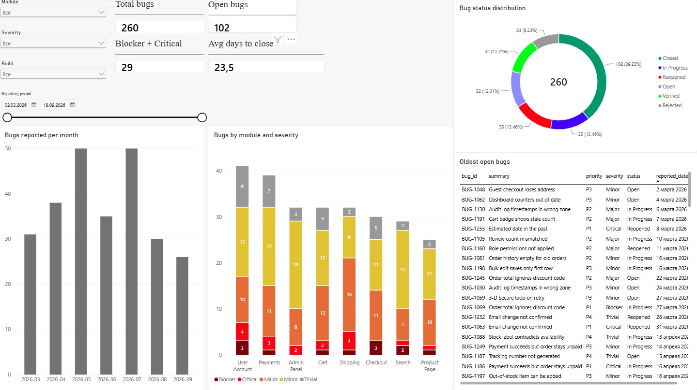
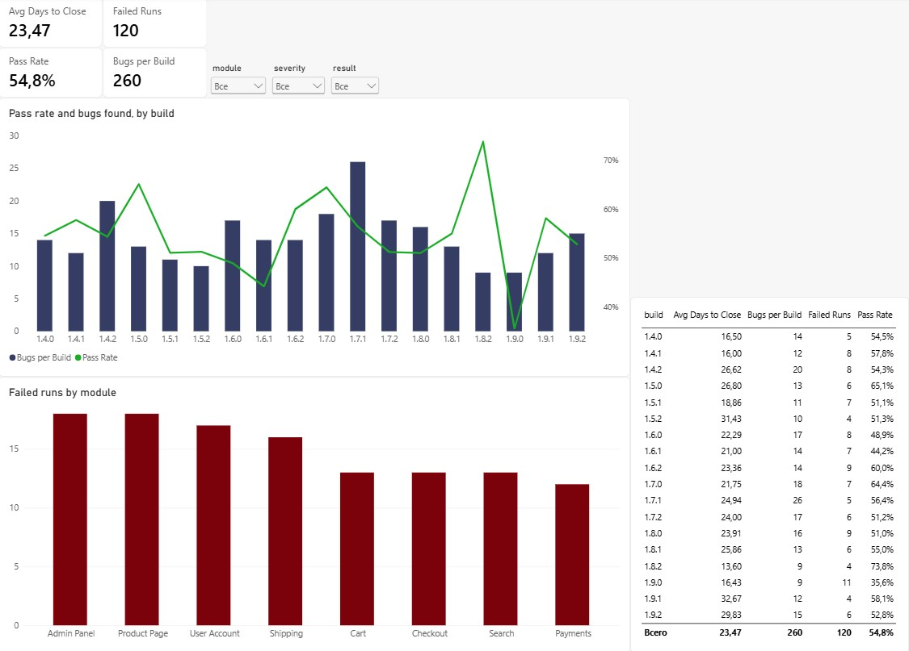

# QA Metrics Dashboard — Power BI

A two-page Power BI report built on bug-tracker and test-execution data for a fictional
e-commerce project (the same domain as my OpenCart testing project).

**The data is synthetic.** It was generated with a script to imitate a raw Jira export,
including the mess a real export usually contains. The data model, the cleaning decisions,
the measures and the analysis are my own work.





---

## Files

| File | What it is |
|---|---|
| `QA_Dashboard.pbix` | The Power BI report — two pages, star-schema model, DAX measures |
| `bugs.csv` | 263 raw bug reports |
| `test_runs.csv` | 794 raw test-case executions |
| `dashboard.jpg` | Screenshot: page 1, Bug Overview |
| `quality-by-build.jpg` | Screenshot: page 2, Quality by Build |

---

## Source data

**bugs.csv** — one row per bug report: `bug_id`, `summary`, `module`, `severity`, `priority`,
`status`, `reported_date`, `closed_date`, `reporter`, `assignee`, `environment`,
`found_in_build`.

**test_runs.csv** — one row per test-case execution: `run_id`, `test_case_id`, `module`,
`build`, `run_date`, `result`, `executed_by`, `duration_min`.

Eight modules, eighteen builds (1.4.0 to 1.9.2), March to September 2026.

---

## Data model

The two files are facts about the same project but share no key out of the box, so the report
is built on a star schema rather than on the flat tables.

**Lookup tables**

- `modules` — 8 rows, derived in Power Query as a reference to `bugs`, reduced to the module
  column with duplicates removed.
- `builds` — 18 rows, derived the same way from `test_runs`.
- `Dates` — a DAX date table, `CALENDAR(DATE(2026,3,1), DATE(2026,9,30))`, with `Year` and a
  sortable `YYYY-MM` month column, marked as the report's date table.

**Relationships** — six, all one-to-many from lookup to fact, all single-direction:

```
modules[module]  →  bugs[module]            modules[module]  →  test_runs[module]
builds[build]    →  bugs[found_in_build]    builds[build]    →  test_runs[build]
Dates[Date]      →  bugs[reported_date]     Dates[Date]      →  test_runs[run_date]
```

Two deliberate decisions here:

**Single-direction filtering, not bidirectional.** Bidirectional filters look convenient and
remove the need to think about direction, but with two fact tables hanging off the same lookup
they create ambiguous filter paths. Power BI then resolves them its own way and returns numbers
that are wrong without raising an error. Single direction costs nothing and keeps the model
predictable.

**`closed_date` is not related to `Dates`.** Only one relationship between two tables can be
active, and the report asks "when was this found", not "when was it closed". Relating the
closing date as a second, inactive relationship would add a trap for whoever opens the file
next without adding anything the report uses.

The model was verified functionally rather than by eye: a table of `modules[module]` against
row counts of both fact tables returns the correct per-module split (32/94, 41/106, and so on)
and the correct totals. If a relationship were missing or reversed, the unfiltered total would
repeat in every row.

---

## Data cleaning in Power Query

This is the part that mattered most. The report took an evening; working out what to do with
the dirty values took longer and is the reason the numbers can be trusted.

| Problem found | What I did | Why |
|---|---|---|
| Three date formats in one column: `2026-04-09`, `15/05/2026`, `05.05.2026` | Custom column with a conditional M expression that detects the separator and rebuilds the value with `#date(...)` | Power BI's automatic type detection silently failed on the mixed column and left it as text. Worse, where it did parse, it could not distinguish `04.09` as 4 September from 9 April — a corruption that is invisible afterwards. Parsing by separator is explicit and reproducible. |
| Build numbers converted to dates: `1.4.0` became `01.04.2000` | Set `found_in_build` and `build` to **Text** in the applied type step, replacing that step rather than adding a new one | A silent corruption: no error is raised and 18 builds collapse into nonsense. It has to be caught by looking at the data. |
| Inconsistent capitalisation: `Checkout`, `CHECKOUT`, `checkout` | Transform → Format → Capitalize Each Word | Without it one module counts as three, every per-module figure is wrong, and the lookup table would have had more than 8 rows. |
| Leading and trailing spaces | Trim (not Clean — Clean removes non-printable characters, which was not the problem) | Same reason: ` Payments` and `Payments` group separately. |
| Two fully identical rows in `bugs.csv` | Remove Duplicates **across all columns** | Important detail: running Remove Duplicates with a single column selected collapsed the table from 260 rows to 19, because many bugs legitimately share a `summary`. The step has to be applied with no column selected. |
| Placeholder row `BUG-1261` with empty fields | Removed | It carries no information and distorts counts. |
| 102 empty `closed_date` values | **Kept** | An empty closing date does not mean missing data — it means the bug is still open. Deleting those rows would delete exactly the bugs the report exists to surface, and would make the average time-to-close look better than it is. |
| 116 empty `duration_min` values in `test_runs.csv` | **Kept as null** | Null means the duration was not recorded, not that the run took zero minutes. Deleting the rows would drop 116 real executions and shift Pass Rate; filling zeros would corrupt any average. Power BI ignores nulls when averaging, which is the correct behaviour here. |
| 32 empty `assignee` values | **Kept** | Unassigned bugs are a finding, not a defect in the export. |
| No time-to-close measure | Added `days_to_close` = `Duration.Days([closed_date] - [reported_date])`, null when the bug is open | Computed at the source so every visual uses the same definition. |
| Months needed for the trend chart | Added a calculated column `FORMAT([reported_date], "YYYY-MM")` | The built-in date hierarchy gives drill-down behaviour rather than a flat month axis, and `MMMM` sorts alphabetically (April, August, December…). `YYYY-MM` sorts chronologically on its own. |

**Verification after cleaning.** bugs: 260 rows, 8 modules, 5 severities, 6 statuses, 0 date
errors, 158 bugs with a closing date and 102 without. test_runs: 794 rows, 8 modules, 4
results, 18 builds, 2 March – 11 September 2026, 116 null durations. The module and build key
sets are identical across both tables, so no fact row is orphaned from a lookup.

---

## DAX measures

```dax
Pass Rate = DIVIDE(
    CALCULATE(COUNTROWS(test_runs), test_runs[result] = "Passed"),
    COUNTROWS(test_runs)
)

Failed Runs = CALCULATE(COUNTROWS(test_runs), test_runs[result] = "Failed")

Bugs per Build = COUNTROWS(bugs)

Avg Days to Close = AVERAGE(bugs[days_to_close])
```

`DIVIDE` rather than `/`: under a slicer combination that leaves no test runs, plain division
raises an error and the visual breaks. `DIVIDE` returns blank, which is the honest answer to
"what share of nothing passed".

---

## The report

**Page 1 — Bug Overview.** KPI cards (260 bugs, 102 open, 29 Blocker + Critical, 23.5 days
average to close), bugs by module and severity, status distribution, bugs reported per month,
and a table of the oldest open bugs. Severity uses an ordered dark red → yellow → grey palette
so it reads as a gradient rather than as five unrelated colours.

**Page 2 — Quality by Build.** A combination chart of bugs found per build (columns) against
Pass Rate (line), failed runs by module, and a table of all four measures per build, with
slicers on module, severity and result.

Two choices on that chart are deliberate. The Pass Rate line is **not smoothed**: a smoothed
curve invents values between builds and would have drawn the collapse at 1.9.0 as a gentle
slope instead of the cliff it is. And the line is green while failures are red, because Pass
Rate going up is good — a red rising line would fight its own meaning.

---

## What the data shows

**Quality is not improving build over build — the newest build is the worst.** Pass Rate on
1.9.0 is 35.6%, the lowest of all eighteen builds, against 73.8% on 1.8.2 immediately before
it. The overall rate is 54.8%, meaning nearly half of all test executions do not pass. Only
nine bugs were logged against 1.9.0, and that is not a sign of health: with a third of runs
passing, the low count more likely reflects testing that stalled than a build that worked.

**Product Page fails most and reports least.** It is the most tested module (113 runs, more
than any other) and has the worst pass rate (47.8%), yet it carries the fewest bug reports (25)
and by far the lowest bugs-per-run ratio — 22 bugs per 100 runs against 39 for Payments. A
module that fails constantly but produces few bug reports points at a gap in the process
between a failed run and a logged defect, not at a healthy module. This is visible only because
the two tables are related; neither file shows it alone.

**User Account carries the most bugs (41) and the most critical ones (7),** and its pass rate
is above average at 60.4%. Severe bugs and failing tests are not the same signal and do not
point at the same module.

**61 of the 102 open bugs are older than 90 days,** and the oldest has been open since 2 March
2026. Several are Critical or Blocker. That is a backlog problem rather than a testing problem.

---

## Tools

Power BI Desktop, Power Query (M), DAX.
